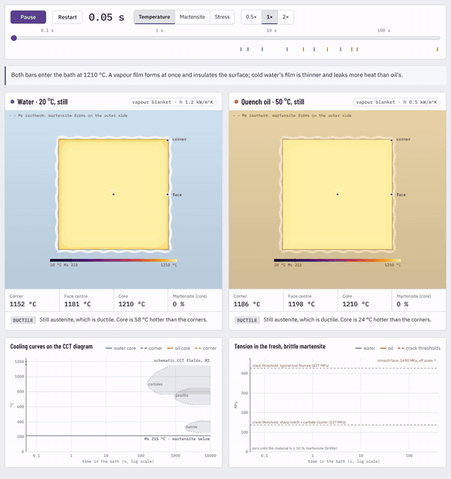

# HSS heat treatment: an animated study

An animation of how a high-speed-steel (AISI M2 / HS 6-5-2) tool is hardened, and a simulation of
what changes when the hardening quench is done in **water** instead of **oil**.



## What is in here

| Path | What it is |
|---|---|
| `web/index.html` | The interactive animation. Open it in a browser (no server needed). |
| `media/` | Rendered videos: the full cycle and the water-vs-oil quench (MP4), plus a GIF preview. |
| `docs/HSS_heat_treatment_study.md` | Study notes: the M2 cycle step by step, quenchant physics, results, references. |
| `sim/` | Python model: 2-D quench of a square tool bit (`model2d.py`), 1-D round blank (`model.py`), M2 properties, quenchant curves. |
| `figures/` | Static figures made by the model. |
| `results/summary.json` | Key numbers for each quenchant. |
| `tests/` | Checks of the model against closed-form solutions. |
| `tools/` | Screenshot, video-recording and artifact-bundling scripts. |

### Part 1: the hardening cycle

Annealed bar → preheat 550 °C → preheat 850 °C (crosses Ac1 ≈ 832 °C) → austenitize 1210 °C for a few
minutes (carbides partly dissolve) → oil quench to hand-warm (martensite below Ms ≈ 215 °C, ≈ 30 %
retained austenite) → three tempers at 560 °C (secondary hardening; retained austenite turns to fresh
martensite on each cooling) → 64–66 HRC. The animation shows the tool in the furnace, a schematic
microstructure and the temperature path, with real durations.

### Part 2: water vs oil

A coupled heat-flow / martensite / stress simulation of a 16 × 16 mm M2 bar plunged from 1210 °C:

| | Water, 20 °C | Oil, 50 °C |
|---|---|---|
| Corners / core reach Ms | 5.3 s / 13.7 s | 52 s / 58 s |
| Core temperature when the corners reach Ms | ≈ 1010 °C | ≈ 234 °C |
| Martensite at the end | ≈ 67 % (same hardness) | ≈ 67 % |
| Peak tension in fresh, brittle martensite | ≈ 160 MPa | ≈ 12 MPa |
| Mean plastic strain (distortion) | ≈ 0.7 % | ≈ 0.2 % |

Water boils violently down to ≈ 110 °C, straight through the martensite range, so the outside of the
bar turns to martensite while the core is still red-hot. When the core transforms later it swells and
pulls the brittle shell into tension. Oil stops boiling at ≈ 320 °C and lets the whole section pass Ms
together. Water gives no extra hardness, about 14× the tension in the martensite and 4× the distortion,
enough to start a crack wherever a sharp notch meets a flaw. See the study notes for the details and the
model's limits.

## Run it

```bash
pip install numpy scipy matplotlib
python -m sim.run                 # simulate water + oil, write web/quench_data.js, results/, figures/ (~10 min)
python -m sim.run --quick         # coarse mesh, ~1 min
python -m sim.run --figures-only  # redraw figures from the last run
python -m unittest discover -s tests -t .

# optional, needs Node + Playwright + ffmpeg
node tools/screenshot.mjs out/     # screenshots, checks console errors and overflow
node tools/record_video.mjs        # renders media/*.mp4 and the GIF
python tools/build_artifact.py     # single-file bundle in dist/
```
