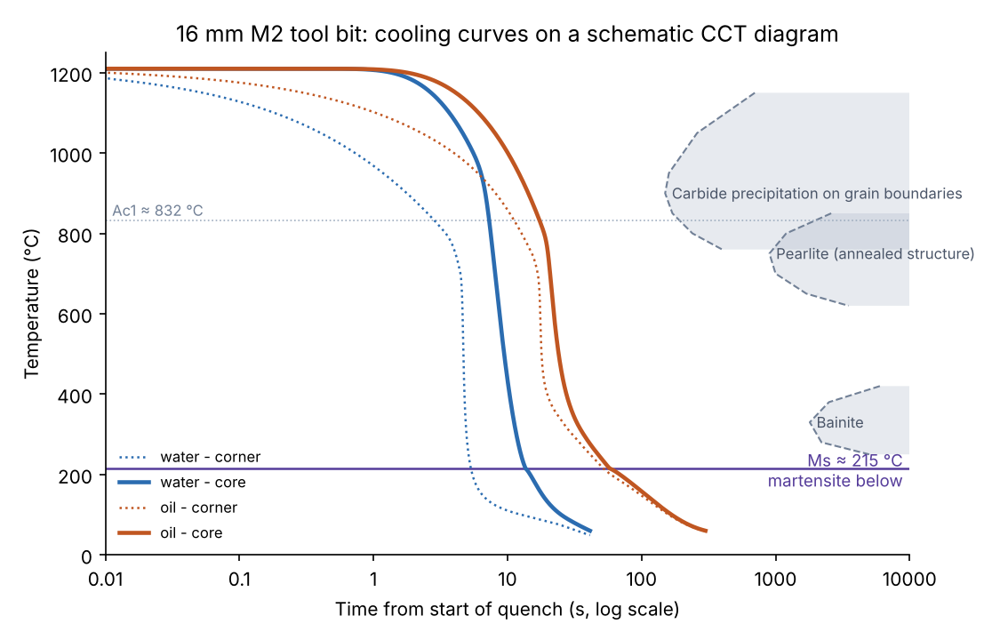
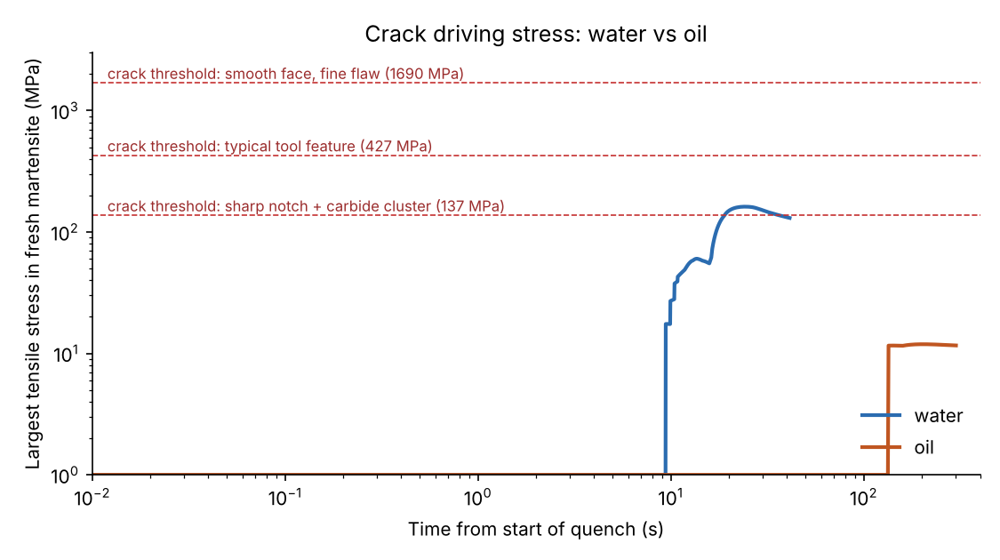
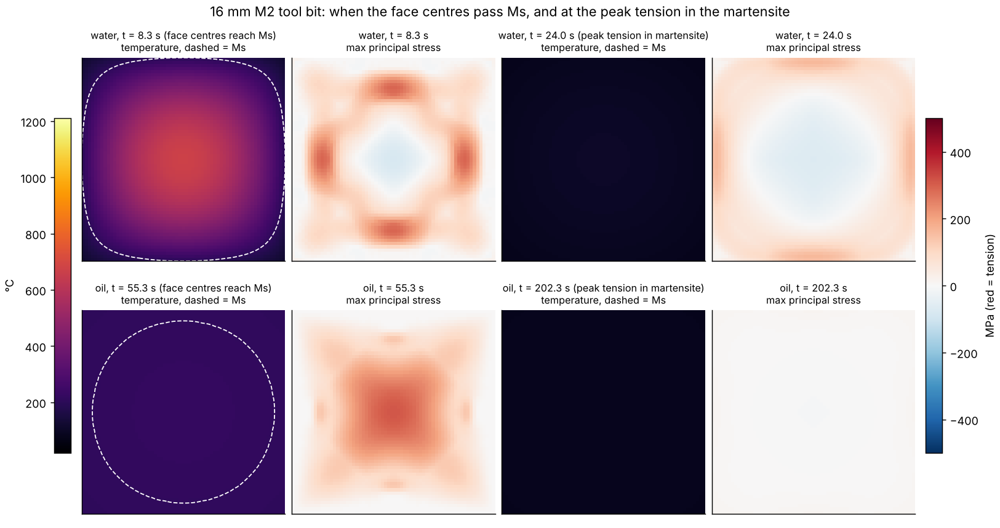

# Heat treatment of high-speed steel (HSS), and quenching in water vs oil

Study notes behind the animation in `web/`. The worked example is **AISI M2 / HS 6-5-2 / W.-Nr. 1.3343**,
the most common high-speed steel. Numbers marked *simulated* come from the model in `sim/`
(`results/summary.json`); everything else is handbook-typical for M2.

---

## 1. What makes HSS different

| Element | wt.% (M2) | Job in the steel |
|---|---|---|
| C  | 0.85–0.95 | Hardness of the martensite; forms the alloy carbides |
| W  | 5.5–6.75  | M₆C carbides; secondary hardening; red hardness (keeps hardness up to ~550–600 °C) |
| Mo | 4.5–5.5   | Same role as W at about half the weight; M₆C and M₂C |
| Cr | 3.75–4.5  | Hardenability (lets HSS harden in oil, salt, gas or even air); M₂₃C₆ |
| V  | 1.75–2.2  | Very hard MC carbides (wear resistance); pins grain boundaries; secondary hardening |

Three consequences drive the whole heat treatment:

1. **The carbides only dissolve near the melting point.** To put enough W, Mo, V and C into
   solution, M2 is austenitized at 1190–1230 °C, only a few tens of degrees below the onset of
   melting at the grain boundaries (≈ 1240–1250 °C).
2. **The steel conducts heat poorly** (≈ 21–25 W/m·K, roughly half of a plain carbon steel), so
   surface and core easily end up far apart in temperature. Hence stepped preheating, and hence the
   danger of severe quenchants.
3. **The hardenability is very high.** The austenite is so loaded with alloy that pearlite and bainite
   need minutes to hours to form. Oil, molten salt, pressurized gas and (for small sections) still air
   all give a fully martensitic structure. A severe quench is never needed.

## 2. The hardening cycle

| Step | M2 practice | What happens in the steel | Why |
|---|---|---|---|
| Soft annealed (as delivered) | 870–900 °C, slow cool; 212–241 HB | Ferrite + ≈ 20 vol.% spheroidized M₆C, M₂₃C₆, MC | Machinable |
| Preheat 1 | ≈ 450–600 °C | Nothing metallurgical | Limits thermal shock and distortion; dries/cleans for salt baths |
| Preheat 2 | ≈ 790–870 °C, until equalized | Crosses Ac1 ≈ 832 °C, Ac3 ≈ 877 °C: ferrite → austenite | Whole section reaches the same temperature before the big jump |
| (Preheat 3, large tools) | ≈ 1000–1050 °C | M₂₃C₆ dissolving | Shortens time at the final temperature |
| Austenitize | 1190–1230 °C (cutting tools 1205–1230; tougher tools 1135–1190), 2–5 min at temperature | M₂₃C₆ fully, M₆C partly dissolved; MC mostly remains. Undissolved carbides pin the grains (ASTM ~10–12) | Loads the austenite with C, W, Mo, V for secondary hardening and red hardness |
| Quench | Molten salt at 540–595 °C then air, warm oil, or pressurized N₂ gas; to 50–65 °C | Below Ms ≈ 200–230 °C austenite → martensite; ≈ 20–40 % retained austenite | Must pass 1000–700 °C fast enough to keep carbides off the grain boundaries |
| Temper ×2–3 | 540–570 °C (≥ 1–2 h each, 1 h per 25 mm), cool to room temperature between | Secondary hardening (fine W/Mo/V carbides); retained austenite is conditioned and transforms to fresh martensite on cooling; the next temper tempers that | 64–66 HRC, < 2 % retained austenite, stable dimensions |

Typical hardness path (M2 hardened from ≈ 1210 °C): ≈ 240 HB annealed → ≈ 64 HRC as quenched →
≈ 65–66 HRC after the first temper at 540–560 °C (secondary-hardening peak) → 64–66 HRC after three tempers.
Tempering below ≈ 450 °C lowers hardness first; the hardness peak only comes once the alloy carbides
precipitate (see `figures/tempering_curve.png`).

Why tempering is repeated: the retained austenite does **not** transform during the hold at 560 °C. It
loses carbon and alloy to carbides, its Ms rises, and it turns into fresh, untempered martensite while
the tool **cools** after the temper. That new martensite is brittle until the next temper. A sub-zero
treatment (−70 to −196 °C) right after the quench converts more austenite earlier but does not replace
tempering.

### Typical faults

| Fault | Cause | Sign |
|---|---|---|
| Incipient melting ("burning") | Austenitized too hot | Eutectic carbide films on grain boundaries, very brittle, cannot be rescued |
| Grain growth | Too hot or too long | Coarse fracture, low toughness (Snyder-Graff intercept count drops) |
| Low hardness / low red hardness | Too cold or too short at temperature | Too little alloy in solution |
| Grain-boundary carbides | Quench too slow through 1000–700 °C (large sections in air or low-pressure gas) | Lower toughness and secondary hardness |
| Decarburized skin | Oxidizing atmosphere at 1200 °C | Soft surface; use neutral salt, vacuum or protective atmosphere |
| Under-tempering | One temper only, or not cooled to room temperature between tempers | Fresh martensite left untempered, chipping |
| Delayed cracking | Left at room temperature too long before tempering | Cracks appear minutes to hours after the quench |
| Naphthalene (fish-scale) fracture | Re-hardened without an intermediate anneal | Coarse, shiny, brittle fracture |
| Quench cracks, distortion | Quench too severe for the geometry (water!), sharp corners, section changes | See section 4 |

## 3. Quenchants: three cooling stages

When a hot part enters a liquid the surface goes through three regimes:

* **A, vapour blanket (film boiling):** an insulating film of vapour; heat leaves by radiation and
  through the film. Slow.
* **B, nucleate boiling:** the film collapses, liquid touches the steel and boils violently. Fastest stage.
* **C, convection:** the surface is below the boiling range of the liquid. Slow again.

For HSS, the question is **where stage B sits relative to the martensite range** (Ms ≈ 215 °C down to
room temperature):

| | Water, 20 °C | Mineral quench oil, 50–60 °C |
|---|---|---|
| Boiling point | 100 °C | ≈ 250–350 °C (boiling range) |
| Stage B (boiling) | ≈ 700 → 110 °C | ≈ 700 → 320 °C |
| Peak h | ≈ 10–20 kW/m²K, around 300–500 °C | ≈ 4–6 kW/m²K around 520–550 °C (measured) |
| h at Ms (≈ 215 °C) | ≈ 11 kW/m²K, still boiling | ≈ 0.3 kW/m²K, convection |

The tables used by the model are in `sim/quenchants.py` and plotted in `figures/htc_curves.png`.
Oil is fast exactly where HSS needs it (1000–500 °C, to avoid carbide precipitation) and gentle where
martensite forms. Water is the reverse: its most violent boiling continues straight through Ms.

Industrial practice for HSS is a salt bath at ≈ 550 °C (marquench: the whole section equalizes above
Ms, then cools slowly in air), warm oil (often interrupted at ≈ 480–540 °C, "until black", then air),
or pressurized nitrogen in a vacuum furnace. Water is not used.

## 4. Water vs oil: what the simulation shows

**Set-up:** a 16 × 16 mm M2 tool bit (cross-section far from the ends), austenitized at 1210 °C, plunged
into still water at 20 °C or still quench oil at 50 °C, and quenched until the core is at 60 °C
("hand-warm", ready to temper). The model (`sim/model2d.py`) solves heat conduction with the
quenchant's h(T_surface), the martensite transformation with its latent heat, and elastic-plastic
stresses with transformation plasticity.

*Simulated results* (`results/summary.json`; numbers change slightly with mesh size):

| | Water | Oil |
|---|---|---|
| Corners / face centre / core reach Ms | 5.3 / 8.2 / 13.7 s | 52 / 55 / 58 s |
| Core temperature when the corners reach Ms | ≈ 1010 °C | ≈ 234 °C |
| Face cooling rate passing Ms | ≈ 30 °C/s | ≈ 2 °C/s |
| Core cooling 800 → 500 °C | ≈ 2 s | ≈ 5 s |
| Time until the core is at 60 °C | ≈ 42 s | ≈ 300 s |
| Martensite at the end (rest retained austenite) | ≈ 67 % | ≈ 67 % |
| Peak tension in fresh (≥ 50 %) martensite | ≈ 160 MPa | ≈ 12 MPa |
| Mean plastic strain (distortion indicator) | ≈ 0.72 % | ≈ 0.18 % |

What this means:

1. **Water adds no hardness.** Both quenches run far to the left of the carbide, pearlite and bainite
   fields and end with the same martensite + retained austenite. Same ≈ 64 HRC.
2. **Water makes the bar transform from the outside in, over a huge temperature difference.** The
   corners become martensite while the core is still at ≈ 1010 °C; in oil the whole section passes Ms
   within ≈ 20 °C and ≈ 6 s. Martensite is ≈ 1 % larger than the austenite it forms from, so the order of
   transformation decides the stresses.
3. **The mismatch loads the brittle martensite.** The shell transforms first and is pushed into
   compression. When the core transforms later it swells and pulls the shell into tension. In water this
   tension reaches ≈ 160 MPa in martensite that is untempered and brittle; in oil ≈ 12 MPa, more than ten
   times lower. Plastic deformation (distortion) is about four times larger in water.
4. **Whether it cracks depends on notches and flaws.** A crack starts when K = Kt·1.12·σ·√(πa) reaches
   the fracture toughness of as-quenched M2 (≈ 10–15 MPa√m). For a smooth face with tiny flaws that
   needs ≈ 1700 MPa; at a typical tool feature (Kt ≈ 2, 50 µm flaw) ≈ 430 MPa; at a sharp notch with a
   carbide cluster (Kt ≈ 3, 150 µm) ≈ 140 MPa. Water passes the last one; oil stays an order of
   magnitude below even that. Real tools have flutes, keyways, holes, thin edges and section changes,
   and real water rewets patchily, adding local stress the uniform model leaves out. This is why HSS is
   not quenched in water.

A note on the smooth bar: in this model a perfectly smooth, uniformly wetted bar does **not** crack in
water. HSS has a low Ms and keeps ~25 % austenite, so much of the outside-in transformation mismatch is
cancelled by the core's thermal contraction before it transforms and by transformation plasticity. That
is a real effect, and it is why the crack risk is reported against flaw/notch cases instead of as a
yes/no for an idealized bar.

The 1-D round-bar version (`sim/model.py`, 25 mm blank) shows the same behaviour; its stress profiles
are in `figures/round_bar_profiles.png`.

## 5. The model in brief

* **Geometry:** quarter of a 16 mm square (two symmetry planes), 32 × 32 bilinear elements,
  generalized plane strain with zero axial force (long bar, free ends).
* **Heat:** k(T) ≈ 21–27 W/m·K, c_p(T) ≈ 450–630 J/kg·K, ρ = 8150 kg/m³, latent heat of martensite
  5·10⁸ J/m³; backward-Euler time stepping with adaptive steps.
* **Martensite:** Koistinen–Marburger, f = 1 − exp(−β(Ms − T)), Ms = 215 °C, β fitted to 25 %
  retained austenite at 20 °C.
* **Mechanics:** E(T) 215 → 125 GPa, ν = 0.3; thermal expansion 20·10⁻⁶ /K (austenite) and
  12·10⁻⁶ /K (martensite); transformation strain 1.0 % (linear, at 20 °C); von Mises plasticity with
  yield ≈ 350 → 25 MPa (austenite, 20 → 1200 °C) and ≈ 2000 MPa (fresh martensite), mixed linearly;
  transformation plasticity K = 5·10⁻⁵ /MPa (Leblond form).
* **Checks** (`tests/`): thermo-elastic stresses against the Timoshenko closed form, energy balance of
  the heat solver, zero stress for a uniform temperature, retained austenite calibration.

Limits: property values are representative, not measured for one heat; uniform wetting; no bar ends,
notches or thin edges in the geometry; no delayed (time-dependent) cracking; schematic CCT fields.

## 6. References

* ASM Handbook Vol. 4, *Heat Treating*: heat treating of tool steels (high-speed steels).
* G. Roberts, G. Krauss, R. Kennedy, *Tool Steels*, 5th ed., ASM International, 1998.
* Hudson Tool Steel, *M2 high speed steel* data sheet (Ac1 832 °C, Ac3 877 °C, hardening and quenching practice).
* G. E. Totten, C. E. Bates, N. A. Clinton, *Handbook of Quenchants and Quenching Technology*, ASM, 1993.
* A. Buczek, T. Telejko, "Investigation of heat transfer coefficient during quenching in various cooling
  agents", *Int. J. Heat Fluid Flow* 44 (2013): mineral oils peak at 4.7–6 kW/m²K around 520–550 °C.
* D. P. Koistinen, R. E. Marburger, *Acta Metallurgica* 7 (1959) 59–60.
* J.-B. Leblond, J. Devaux, J. C. Devaux, "Mathematical modelling of transformation plasticity in steels",
  *Int. J. Plasticity* 5 (1989).
* S. Timoshenko, J. N. Goodier, *Theory of Elasticity* (thermal stresses in a long cylinder).
